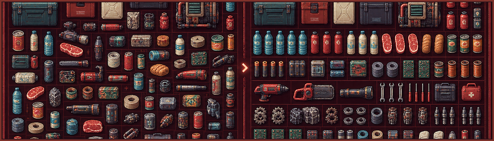

# Smart Inventory Arrange 3.11.0 / 智能排列

适配 Probably Stolen Demo 0.46D、Unity 2021.3.45f2、MelonLoader 0.7.3 x64（IL2CPP）。
## v3.11 当前版本

当前源代码、纯算法测试和脚本均来自已验证的 v3.11.0 构建；仓库不包含游戏或 MelonLoader 的专有程序集。

## v3.9.1 修复

- 修复对称物品或第三方 Mod 物品使用方向 2/3 时，方向掩码去重导致 `Sequence contains no matching element` 的快照异常。
- 原始布局直接使用捕获的 `GridShape` 生成掩码，同时保留游戏实际方向编号，不再要求方向编号存在于去重模型中。
- 修复发生在任何移动之前；排列算法、事务应用和最终坐标日志保持 v3.9 行为。
## v3.9 变化

- 每个 X 只保留最低合法 skyline 前沿，不再枚举该列全部 Y 坐标。
- 同分类原子块使用累计邻接距离，视觉竞争优先保持分类区域连续。
- 100 件以上容器使用 6 状态/5 候选的确定性块级 beam。
- 中间候选不再重复生成完整 PlacementKey，也不再对每个候选执行整张网格 Raggedness。
- 30x30、179 件合成回归从秒级降至测试运行中的约 304ms，同时保持 `typeSplits=0`。
- 保留 v3.8 的混合尺寸同 ID 原子块与排序后全部物品坐标日志。
## v3.8 变化

- 同一 `ItemId` 下的不同实际尺寸使用各自已验证的游戏占格与方向，但保持在同一个连续原子块中。
- `system_module_performance`、`system_module_quality` 等 2x2/2x3 混合实例不再令整个 skyline 快速路径失败。
- 原子路径失败会在主日志的 `diagnostic=` 中记录具体物品或失败阶段。
- 每次排序结束都会在 `MelonLoader\Logs\SmartInventoryArrange-Snapshot.log` 中追加全部物品的最终 `Coordinate (x,y)`、最终尺寸和方向。
- 成功应用、保留原布局、空容器及事务回滚都会写入对应的结果段。
## v3.7 变化

- 用同物品类型不可拆原子块替代僵硬的全宽逐行推进。
- 使用 skyline 轮廓候选与 24 状态有限回溯；矮块可填入高块侧边空间。
- 完整零拆组 skyline 候选直接胜出；无法形成单行原子块时保留原有安全回退。
- 保持视觉优先顺序、竖放优先、确定性稳定 ID 决胜和事务式应用。
- 每次点击智能排列都会追加写入 `MelonLoader\Logs\SmartInventoryArrange-Snapshot.log`，记录容器尺寸以及全部物品的名称/ID、尺寸、类型、分类、方向、可旋转和可移动状态。
- 不记录“是否位于同一区域”或“最终是否被拆散”。

## v3.3 性能变化

- 纯布局搜索放入后台任务，Unity/IL2CPP 快照与事务应用仍只在主线程执行。
- 24x10 容器默认搜索预算从 750ms 调整为 400ms，beam/candidate 为 40/28。
- 截止检查深入到状态、候选和坐标循环，避免单次展开把预算超出到 1.8 秒。
- 候选预排序不再为每个坐标重复执行全网格碎片 flood-fill；完整状态评分仍保留空洞和碎片指标。
- 中间 beam 状态不再反复生成完整 StableTie 字符串，最终比较仍使用稳定 ID。
- 缓存上一次确定性结果；相同布局连续点击直接返回。
## 本版目标

- 适用于当前打开的任意尺寸 `GameGridInventory`：仓库、背包、容器和机器内部库存。
- 只整理当前库存，不递归修改嵌套容器。
- 视觉顺序：容器/背包 → 机器 → 未知 → 其他目录分类（仅使用结构化 `itemTypes`）。
- 每个分类中保持同物品类型连续，按整组最大尺寸决定大件组优先。
- 优先竖放；只有完整布局需要时才使用最少的横放例外。
- 候选位置首先从上到下、从左到右，再比较同类型接触、分类接触、空洞和边缘。
- 根据格子数量使用 150/350/750ms 确定性搜索预算。
- 锁定/不可移动物品原位保留，禁用格作为障碍。
- 只在候选完整且严格优于原布局时事务式提交；任何游戏 API 拒绝都会恢复快照。

## 构建

```powershell
dotnet build .\src\SmartInventoryArrange\SmartInventoryArrange.csproj -c Release -p:GameDir="E:\steam\steamapps\common\Probably Stolen Demo"
New-Item -ItemType Directory .\dist -Force | Out-Null
Copy-Item .\src\SmartInventoryArrange\bin\Release\net6.0\SmartInventoryArrange.dll .\dist\SmartInventoryArrange.dll -Force
```

项目引用实际游戏及 MelonLoader 安装中的程序集，不复制游戏专有程序集到发布包。

## 安装

关闭游戏后运行：

```powershell
powershell -ExecutionPolicy Bypass -File .\scripts\Install.ps1 -GameDir "E:\steam\steamapps\common\Probably Stolen Demo"
```

默认安装到：

`E:\steam\steamapps\common\Probably Stolen Demo\Mods\SmartInventoryArrange.dll`

已有同名 DLL 会先创建时间戳备份。

## 测试

```powershell
dotnet run --project .\tests\SmartInventoryArrange.Tests\SmartInventoryArrange.Tests.csproj -c Release
```

测试包含 v2 全部回归场景，以及不同尺寸背包/容器、内部空间物品优先、同类型连续、大件组优先、顶部紧凑和最少横放例外。

## 回滚

```powershell
powershell -ExecutionPolicy Bypass -File .\scripts\Uninstall.ps1 -GameDir "E:\steam\steamapps\common\Probably Stolen Demo"
```

或在 Git Bash 中执行 `ROLLBACK.sh`。脚本恢复安装前的精确 DLL，不修改其他 Mod。

## 当前限制

- 为隔离 alpha.1 的 `coreclr.dll` 原生闪退，本版不再读取新增的 `GameItem.child` IL2CPP 属性；容器、背包和机器优先级来自结构化 `itemTypes`。
- 不规则物品仍用游戏真实占格验证；视觉评分不会为了利用小凹槽而强制穿插其他物品。
- 纯算法测试不能代替实际存档中的 UI、保存重载和 Mod 兼容性验证。


## v3.3 shelf-group layout

- Reserves a contiguous horizontal shelf for each exact item type when possible.
- Keeps identical-height copies on the same top-aligned row and minimizes split runs.
- Keeps portrait orientation as a strict preference before shelf aesthetics.
- Falls back deterministically when obstacles or capacity prevent a single shelf.


## v3.4 visual-first competition

- Keeps the existing container/category detection unchanged.
- Scores exact-type shelf continuity before category ordering and space cosmetics.
- Treats an exact identifier group as one shelf group even if primary-category metadata differs.
- Preserves existing high-priority-item ordering, portrait preference, deterministic output, and transactional application.


## v3.5 hard visual cohorts

- Exact-type split count is the first layout criterion after completeness and area.
- Same-category items with the same portrait footprint form a visual shelf cohort, while exact types remain consecutive subgroups.
- Category and existing priority order can no longer compensate for splitting a type or cohort.
- Success/keep logs expose type and cohort split diagnostics for live verification.
- Existing container detection is unchanged.


## v3.6 atomic shelf-row planner

- Builds complete top-down shelf rows from exact-type blocks before item-level beam search.
- Returns an atomic zero-type-split shelf solution immediately when legal.
- Same-height visual cohorts share rows; exact-type blocks never interleave.
- Rotation state is absolute: landscape is always an exception, independent of the input snapshot orientation.
- Success logs list any exact identifiers that remain split.
- Existing container detection is unchanged.

## v3.10 density-adaptive planning

- Logs true mask occupancy and the selected `aesthetic`, `balanced`, or `dense` mode on every sort.
- Below 80% occupancy, preserves the established visual-first atomic skyline behavior.
- From 80% to below 92%, balances exact-type shelves with fragmentation and edge regularity.
- At 92% or higher, ranks holes, narrow fragments, edge regularity, container/large-item order, and compactness before optional shelf perfection.
- Dense MaxRects candidates may select a legal horizontal orientation when it materially improves packing.
- `kept-original` logs now include `candidate-incomplete`, `density-score-equal`, or `baseline-density-score-better`.
- The transactional apply/rollback path and final per-item coordinate snapshot are unchanged.

## v3.11 dense local-search refactor

- Keeps the verified snapshot, native rotation, transaction, rollback, menu, and coordinate diagnostics.
- Dense mode now starts from the already legal layout and reassigns equal-shape items among existing slots, so it can join split families without needing temporary empty cells.
- Exact-type blocks may wrap into the minimum number of adjacent rows instead of failing when one row is wider than the container.
- Type split counts now measure orthogonally connected regions; wrapped adjacent rows remain one visual region.
- Dense and balanced comparison is visual-first: exact-type regions/rows/contacts and category continuity precede fragmentation compromises.
- Candidate rejection logs include the first deciding metric plus candidate/baseline space metrics.
- Regression fixtures include log-derived 19x12/97.4% (58 items) and 30x30/95.1% (215 items) item mixes.
- Search-time optimization is intentionally deferred for this release.


