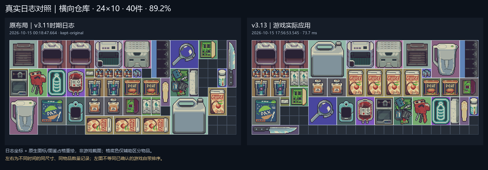
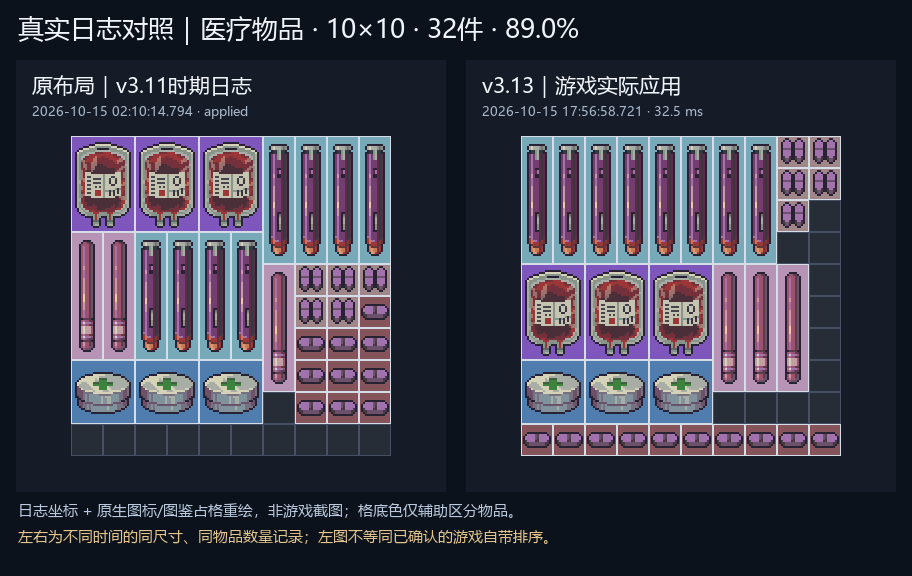
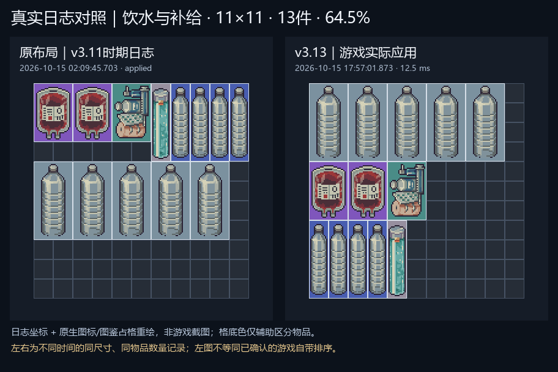

# SmartInventoryArrange · 智能排列

为 **Probably Stolen Demo** 提供确定性、视觉优先的库存整理。

**当前版本：v3.13.0（预发布）** · [下载发布包](https://github.com/xiepeixuan/SmartInventoryArrange/releases/tag/v3.13.0) · [验证记录](docs/VALIDATION.md)

> 本版已完成构建、离线回归、安装哈希检查和隔离回滚测试，并新增下方三组游戏内成功应用日志。存档重载、故障恢复及多Mod兼容性仍待验证；日志坐标重绘与离线回放均不冒充完整游戏测试。

## 真实日志对比

以下右图来自 **2026-10-15最新v3.13会话的实际`applied`结果**，不是离线算法生成候选。左图来自同尺寸、同`ItemId`数量的v3.11时期历史布局。

> 图像按日志坐标、原生图标和图鉴占格重绘，**不是游戏截图**。两侧来自不同时间记录，不是同次点击前后快照；日志没有导出点击前坐标，也没有证明左图由游戏自带排序生成，所以这里明确使用“历史原布局→v3.13实际应用”，不标成“游戏原版排序”。同物品集合不等于已核实同一批原生实例或状态。

### 横向仓库：24×10，40件，89.2%

代糖果汁从横竖混用、分散，变为统一竖放并排；顶部大件重新组织。右图当次求解日志为 **73.7ms**。



### 医疗库存：10×10，32件，89.0%

历史布局中被拆开的三支同类注射剂在右图中集中成排，其他同类药品也按行组织；额外同类型区域数由1降为0。右图当次求解日志为 **32.5ms**。



<details>
<summary>补充案例：11×11补给库存，13件，64.5%——大件前置的取舍</summary>

右图将大瓶饮水提前到顶部，右侧留白也更多；此例不作为“空白压缩更好”的证明。右图当次求解日志为 **12.5ms**。



</details>

以上耗时只是对应日志中的单次求解耗时，不是点击至UI完成的端到端耗时，也不用于计算旧版/新版提速倍数。图鉴掩码没有替代逐实例游戏状态验证。[来源、配对规则与局限](docs/COMPARISONS.md)

## 排列思路

- **优先成排**：相同物品尽量相邻并排；放不下一排时，优先少量、相邻的换行，而不是散布整个容器。
- **大件在前**：容器、背包、机器和大件优先靠上，整体从上往下排列。
- **方向协调**：同组尽量方向统一，通常优先竖放；必要时允许合法旋转，不规则物品使用游戏真实占格进行拼合。
- **边界整齐**：尽量减少中部空洞、无意义穿插和参差边界，让余下空白更集中。
- **不硬套一种尺寸**：根据当前库存的实际宽高、可用格、固定障碍和物品形状求解，面向仓库、背包、容器及机器库存；只整理当前库存，不递归整理内部容器。

这些是优化目标，不是“任何库存都能得到最优排列”的保证。锁定物品、障碍和接近满载的空间会限制可行布局。

## 运行环境

|项目|当前适配环境|
|---|---|
|游戏|Probably Stolen Demo 0.46D|
|Unity|2021.3.45f2，IL2CPP|
|加载器|MelonLoader 0.7.3 x64|
|运行目标|Windows x64 / .NET 6|

使用发布 DLL **不需要 Python**，也不需要下载离线研究资源。其他游戏版本和加载器版本尚未验证。

## 安装

1. 关闭游戏，确认已经安装对应的 MelonLoader。
2. 在[发布页面](https://github.com/xiepeixuan/SmartInventoryArrange/releases/tag/v3.13.0)下载 ZIP 并解压。
3. 如果已有旧版，将旧 `SmartInventoryArrange.dll` 备份到游戏 `Mods` 目录以外。
4. 只复制新的 `SmartInventoryArrange.dll` 到：

   ```text
   <游戏目录>/Mods/SmartInventoryArrange.dll
   ```

5. 启动游戏，在 MelonLoader 日志中确认加载版本为 `v3.13.0`。

不要把整个源码目录、测试目录或游戏依赖程序集复制进 `Mods`。更新只替换本 Mod 的同名 DLL。

发布 DLL 的 SHA256：

```text
53662E8D54D21A78F843F5488350EBDA663CFAAD170EF1AFCE65FB4F327D6A6D
```

PowerShell 校验示例：

```powershell
Get-FileHash -Algorithm SHA256 -LiteralPath '.\SmartInventoryArrange.dll'
```

## 使用

1. 打开需要整理的库存，以及游戏原有的排序菜单。
2. 点击新增的 **“智能排列”**；非中文游戏环境显示 **“Smart Arrange”**。
3. 等待计算结束，随后由游戏主线程应用布局。正在排列时，重复请求会被忽略。
4. 相同布局再次点击可能直接跳过，这是确定性结果缓存的正常行为。

没有新增独立快捷键。计算期间不要移动目标库存中的物品；应用前会再次核对快照。

## 物品与事务保护

- 排列前捕获完整快照，保留稳定实例标识、原始坐标、游戏方向及真实占格。
- 固定、锁定、不可移动物品保持原位，禁用格始终作为障碍。
- 最终布局检查物品一一对应、方向合法、不重叠、不越界。
- 求解只处理托管快照数据；Unity/IL2CPP 对象访问和应用仍在原有主线程流程内。
- 事务应用失败时执行完整快照恢复，不通过创建、销毁或修改物品状态来实现整理。

以上为实现机制与离线检查范围；实际存档、游戏 API 故障恢复和其他 Mod 交互仍需游戏内验证。

## v3.13 更新内容

v3.12 引入了从空闲可用空间全局生成布局、同类整组模板、相邻换行、视觉锚点和不规则形状拼合。**v3.13重点是保持输出的性能优化，而不是另换一套审美规则：**

- 模板占格预计算为位掩码，平移时复用，减少逐格重建。
- 使用“占格 + 剩余数量向量”的精确结构化搜索键，减少字符串分配；哈希碰撞仍通过完整相等判断区分。
- 延迟创建布局对象，减少搜索中间数组、集合和排序键分配。
- 在单次求解内复用几何指标；方向相关模板和选项每轮重新建立。
- 只在最优几何评分并列时计算偏好模型特征，保留原有决胜规则。
- 冻结偏好模型内嵌 DLL、延迟加载；运行时不训练模型，也不允许模型绕过硬约束。
- 提供逐轮、逐路线的耗时、累计托管分配和节点诊断。

26条候选路线、每路线25万节点预算、最多8轮的固定点检查和视觉准入规则保持不变。旧 `DeterministicSolver` 保留用于回归及诊断；实际游戏入口使用 `Native34Solver`。日志里的占用率模式名称不代表三套独立求解器。

### 离线性能对照

同机、相同输入、串行交替三轮，以下为完整求解的平均耗时：

|历史回放场景|v3.12|v3.13|提速|
|---|---:|---:|---:|
|19×12、58件、约97.4%占用率|38.35秒|4.78秒|8.02倍|
|30×30、215件、约95.1%占用率|16.17秒|3.45秒|4.68倍|

两例使用历史日志的**矩形近似占格**，不是本版游戏内原生形状实测。各场景收益不同，高密度仍可能需要数秒，**400ms不是本版的硬截止承诺**。累计分配量减少也不等于峰值内存同比下降。

[逐场景均值、P95、最大值与分配量](docs/performance-v3.13.csv) · [方法与局限](docs/VALIDATION.md)

## 测试状态

|项目|结果|
|---|---|
|旧算法回归|59/59|
|原生求解器安全检查|53/53|
|缓存、状态键碰撞、异形位掩码等专项断言|711/711|
|v3.12/v3.13输出对照|50/50个场景配置一致|
|主场景完整、合法、重复排列稳定|26/26|
|开发集视觉规则|19/20，例15仍未达标|
|真实日志输入的离线视觉规则|4/4|
|偏好特征跨语言核对|600/600|

50个配置包含26个主场景及24个尺寸/方向/预算配置，不表示50个独立玩家库存。对照包含坐标、方向、最终候选记录、评分特征和节点诊断，不只是最终分数。

本公开仓库可独立执行下列三组代码测试；私人日志、盲选标注和完整离线实验集不随仓库分发。

## 从源码构建

安装 .NET SDK **6.0.428**（仓库 `global.json` 使用6.0系列补丁滚动）。本机需要真实的游戏和 MelonLoader 安装，仓库不提供这些依赖 DLL。

```powershell
dotnet build .\src\SmartInventoryArrange\SmartInventoryArrange.csproj `
  -c Release --nologo -warnaserror `
  -p:GameDir="E:\steam\steamapps\common\Probably Stolen Demo"
```

输出：

```text
src/SmartInventoryArrange/bin/Release/net6.0/SmartInventoryArrange.dll
```

也可通过环境变量 `PROBABLY_STOLEN_DIR` 指定游戏目录。编译环境与调试路径不同可能影响二进制哈希；上述SHA256对应本次发布的已验证DLL。

### 纯算法测试（不需要游戏程序集）

```powershell
# 59项旧算法回归
dotnet run --project .	ests\SmartInventoryArrange.Tests -c Release

# 53项原生求解器安全检查
dotnet run --project .	ests\SmartInventoryArrange.NativeSafety -c Release

# 711项性能实现专项断言
dotnet run --project .	ests\SmartInventoryArrange.PerformanceSafety -c Release
```

## 日志与反馈

游戏主日志位于 `<游戏目录>/MelonLoader/Logs`，物品快照与最终坐标位于：

```text
MelonLoader/Logs/SmartInventoryArrange-Snapshot.log
```

反馈时建议附上容器尺寸、占用率、排列前后截图、当次主日志和对应快照片段，并说明是否在同一容器重复整理。日志包含物品信息，发布前请自行检查希望公开的内容。

`success`、`kept-original`、`skipped` 与 `cancelled/restored` 表示不同结果；保留原布局或跳过并不自动表示排序出错。

## 回滚与卸载

- **手动安装**：关闭游戏，用安装前备份的同名 DLL 覆盖当前 DLL；若之前没有此Mod，移走 `Mods/SmartInventoryArrange.dll` 即可卸载。
- **仓库脚本安装**：`scripts/Install.ps1` 接收 `-GameDir` 和 `-DllPath`，并记录旧DLL备份；使用同一份脚本目录中的 `scripts/Uninstall.ps1` 或根目录 `ROLLBACK.sh` 恢复。运行前关闭游戏，并保留备份与标记文件。

不要将离线实验中的“恢复到v3.12”与实际安装前备份混用；应恢复你本次安装前的确切版本。

## 当前限制

- 这是有限、确定性的候选搜索，不保证全局最优，也不保证任意异形高密度库存都会变得更整齐。
- 本版未新增解决开发视觉例15；视觉改善与提速须分别评估。
- 没有独立冻结测试集上的新胜率结论；内嵌偏好模型来自开发集，不能视作已校准的视觉置信度。
- 构建、离线回放、安装校验和游戏内验证分别记录；本节三组已有实际应用日志，其他场景、存档重载及多Mod交互仍需验证。
